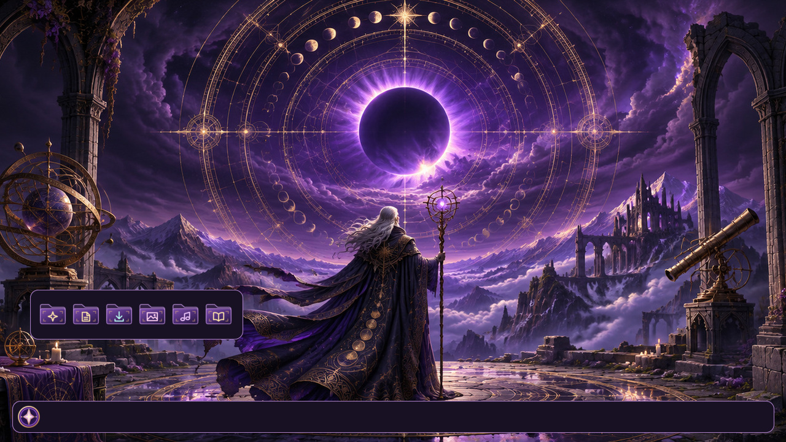
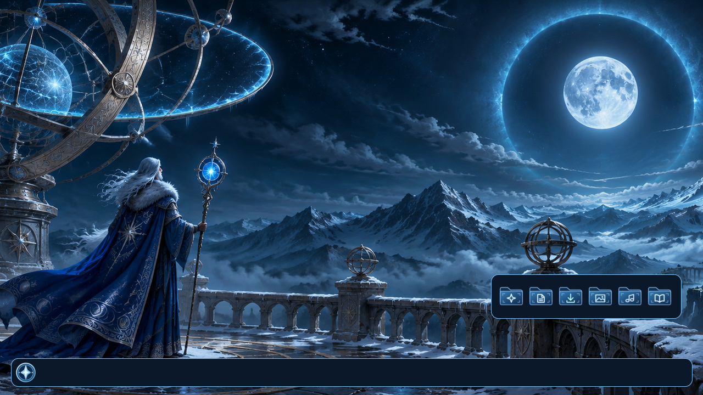

# Archmage for KDE Plasma 6

A dark fantasy desktop with midnight-indigo surfaces, amethyst highlights, and antique gold. The two ultrawide wallpapers are **Eclipse Observatory** and **Midnight Library**. The icon theme adds an eclipse sigil for the application launcher and amethyst folders with symbols for common locations, including Home, Downloads, Pictures, and Documents. Other icons inherit from Breeze.




## Archmage Sapphire

Sapphire pairs a midnight-navy panel and ice-cyan highlights with silver-trimmed folder icons and a sapphire eclipse launcher. Its two ultrawide wallpapers are **Lunar Observatory** and **Glacial Scriptorium**.



## Install and apply

From the project directory, run:

```sh
./install.sh
```

The installer adds both editions. Open **System Settings → Colors & Themes → Global Theme**, select **Archmage** or **Archmage Sapphire**, then apply its appearance settings. Leave any desktop layout option unchecked to keep your panels and widgets.

- **Wallpaper** — Right-click the desktop and open **Configure Desktop and Wallpaper**. Choose one of the four Archmage wallpapers from the grid. Use **Scaled and Cropped** for edge-to-edge artwork on a 16:9 display. Use **Scaled** to fit the full ultrawide composition.
- **Taskbar launcher** — If your Application Launcher uses a custom icon, right-click it and open **Configure Application Launcher**. Click the current icon, choose **Choose…**, and search for `archmage-launcher` or `archmage-sapphire-launcher`. You can also use **Browse…** and select the [violet launcher SVG](theme/icons/Archmage/scalable/apps/archmage-launcher.svg) or the [Sapphire launcher SVG](theme/icons/ArchmageSapphire/scalable/apps/archmage-sapphire-launcher.svg).
- **Individual components** — You can select either edition under **Plasma Style**, **Colors**, or **Icons** in System Settings.

The installer copies the theme into `${XDG_DATA_HOME:-$HOME/.local/share}` and does not modify the active Plasma session.

## Wallpaper artwork

The wallpapers were created with the built-in image generation tool.

- **Eclipse Observatory** — Use case: stylized-concept. Original ultrawide KDE wallpaper, cinematic dark fantasy matte painting. An archmage in flowing midnight robes stands before a luminous violet eclipse and immense concentric spell circle in a ruined mountaintop observatory. Amethyst and midnight indigo with restrained antique gold, richly detailed, dark quiet margins for desktop icons, no text or watermark.
- **Midnight Library** — Use case: stylized-concept. Original ultrawide KDE wallpaper, cinematic dark fantasy matte painting. An abandoned archmage library at midnight, towering shelves and pointed arches framing a floating open spellbook with luminous violet wisps, warm amber lanterns, midnight indigo shadows, quiet dark margins for desktop icons, no text or watermark.
- **Lunar Observatory** — Use case: stylized-concept. Ultrawide KDE dark fantasy wallpaper, cinematic hand-painted matte art. Lone sapphire archmage on an ancient snowy observatory terrace, beneath a glacial blue lunar halo and luminous astrolabe rings, distant jagged mountains, midnight navy, ice cyan and brushed silver, quiet dark margins, no text or watermark.
- **Glacial Scriptorium** — Use case: stylized-concept. Ultrawide KDE dark fantasy wallpaper, cinematic hand-painted matte art. Ancient vaulted scriptorium underneath a glacier, a floating open grimoire radiates pale cyan wisps over a shallow reflecting pool, carved pillars, frozen arches, sapphire blue and silver, quiet dark margins, no text or watermark.
